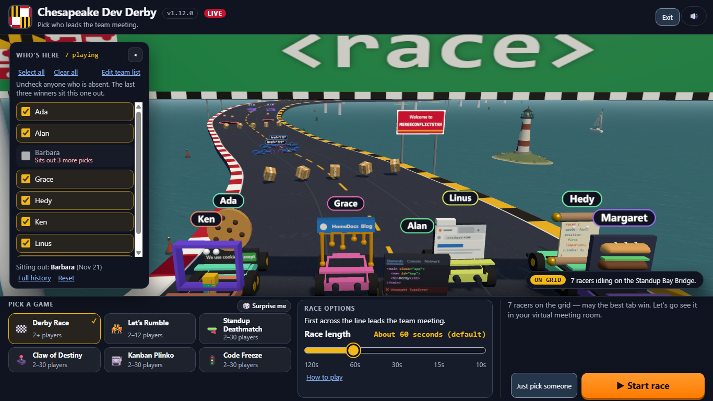
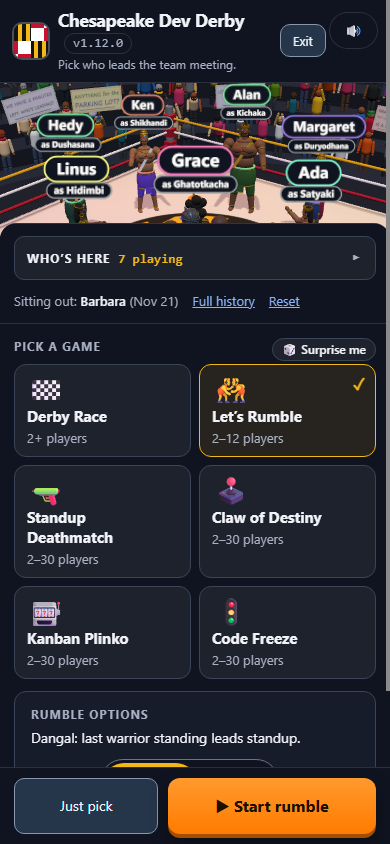
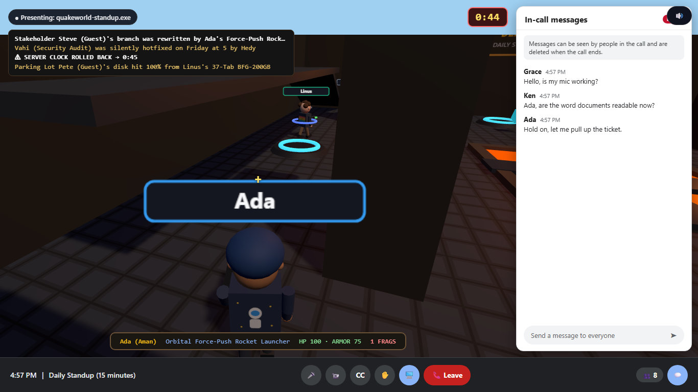
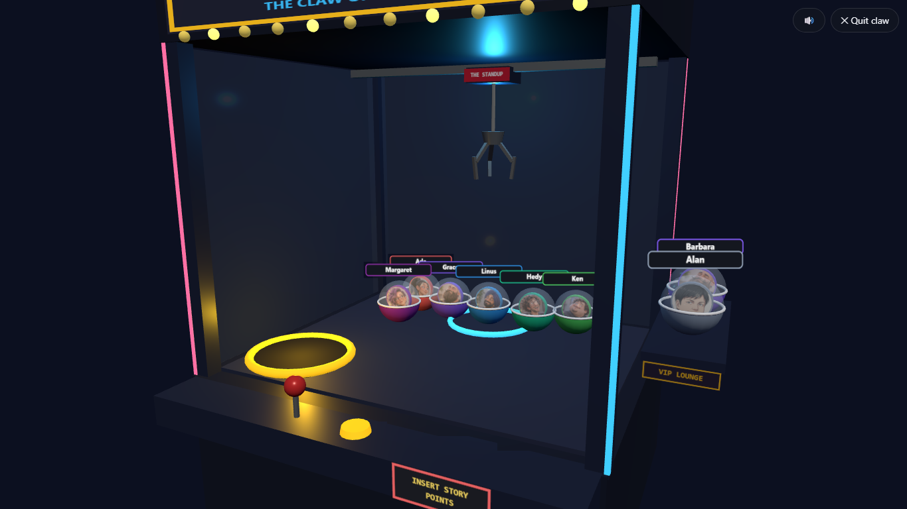
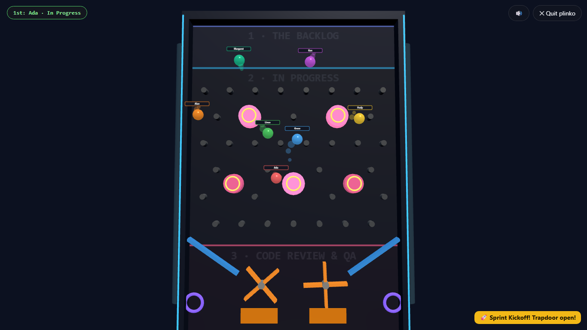
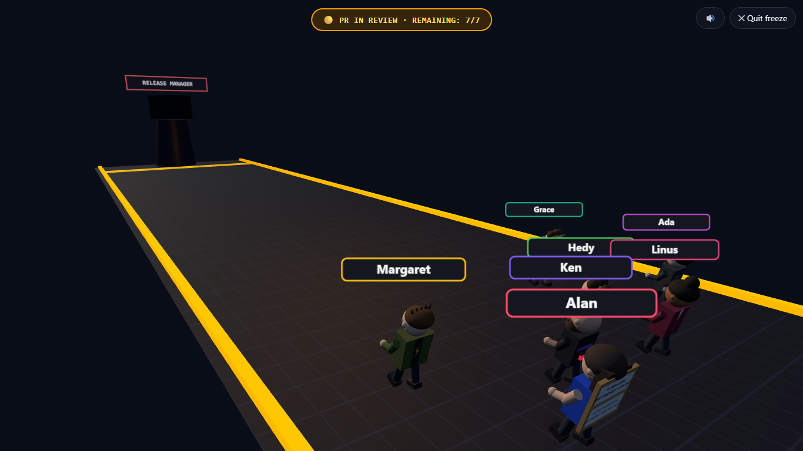

# Chesapeake Dev Derby

Pick who leads the team meeting — by racing for it.

Every name on your roster becomes a 3D kart racer (a browser tab, a cookie banner, a hamburger menu…) and
runs an obstacle course of web-developer hazards over the Chesapeake Bay. First across the line leads the
meeting. The **Race length** slider offers about 120, 60 (the default), 30, 15 or 10 seconds.

**Run it on the meeting screen; everyone watches.** The derby is a presenter app: one person runs it on
their own computer and shares that screen (or shows it on the room display). Participants do not open it
on their own phones or laptops; the app only accepts connections from the computer it runs on, and every
browser would run its own, different race anyway.

Built with [Three.js](https://threejs.org/) and a tiny zero-dependency Node server.

**Try the demo:** <https://roscoe-sincero-sys.github.io/Chesapeake-Dev-Derby/>: a browser-only copy
with sample names; see [Online demo](#online-demo).

## Quick start

You need [Node.js](https://nodejs.org/) 18 or newer.

```bash
npm install     # first time only (downloads Three.js)
npm start       # then open http://127.0.0.1:4100
```

`npm run open` does the same and opens your browser for you. On Windows you can also double-click
**`start.cmd`**. This launcher automatically stops the server and closes its terminal about three
seconds after the last game or roster-editor tab closes. Reloading or moving between those screens keeps
it running. On startup it waits up to four seconds for an existing tab to reconnect, avoiding a duplicate
tab after you stop the server with Ctrl+C and restart the launcher. `npm start` and `npm run open` keep
running until you press Ctrl+C.

**Exit** (top right of the lobby) closes the app however you started it: the server stops, the launcher's
terminal closes, and the page says the Derby is closed. Hover over it for a reminder. Your team list and
winners are already saved, so nothing is lost; start the app again to carry on.

To use a different port: `PORT=5000 npm start` (PowerShell: `$env:PORT=5000; npm start`).

## Running a meeting pick

1. **Edit the team list** using **Edit team list** in the lobby (the **Roster Studio**), or in `data/names.json` — up to 30 names.
   The Roster Studio shares the lobby's top bar and keeps the live 3D stage open on the right on wide
   screens: add or remove teammates with interactive **Roster chips** (watching them appear live on the
   3D stage before you save), check the live mode-fit badges (**Derby Race 2+**, **Let's Rumble 2–12**),
   or switch to **Bulk text / paste** to paste a list all at once. A fresh copy of the repo has no team
   list yet: the lobby says it can't find `data/names.json`, and saving from **Edit team list** creates
   it. The file stays on your computer; like the winner files, it is listed in `.gitignore` so your
   team's names are never committed:

   ```json
   { "names": ["Ada", "Grace", "Linus"] }
   ```

   **Pasting from a calendar invite?** Labels that calendar apps put on their own line in an attendee
   list are ignored, so only the people end up on the team: Organizer, Required, Optional, response
   statuses (Accepted, Tentative, Declined, No response…) and work locations (Home, Office, In office,
   Telework, Remote, In person, Out of office). They're matched against the whole line, ignoring case and
   surrounding brackets or colons, so `(Optional)` and `Telework:` are skipped too, but a name like
   "Homer" is kept. The editor says how many were skipped.

   A plain array (`["Ada", "Grace"]`) works too. Blank entries and duplicates are ignored, and anything
   past the 30th name is dropped (the lobby tells you when this happens). Reload the page after editing.

2. **Open the lobby.** The lobby is a **Live Broadcast Stage**: the selected game plays live in 3D
   behind solid panels.
   - **On a wide screen** (1000 px and up) the 3D stage fills the middle. **Derby Race** shows the
     checked-in teammates idling on the Standup Bay Bridge, then glides down the course; **Let’s Rumble**
     shows them in the spotlit wrestling ring, and switching **Classic | HD** swaps their models live.
     Around the edges:
     - the **top bar**: `LIVE`, **Exit** and mute (the history and the team list open from the
       **Who's here** drawer: **Full history** and **Edit team list**);
     - the **Who's here** drawer on the left, which scrolls on its own and folds away with `◂` or **H**
       for a full spectator view;
     - a **chyron** over the stage, rotating pre-match notes (who's on the grid, who hasn't won in a
       while, who's sitting out);
     - the **dock** along the bottom: **Pick a game** with **🎲 Surprise me**, the selected game's
       options, then **Just pick someone** and **Start**.
   - **On a phone** a window onto the 3D stage sits above the lobby. The team list folds into a
     **Who's here · 12 playing** row (open to start with when fewer than two people are ready), and
     **Just pick** and **Start** stay at the bottom in one row.

   <p>
     
     
   </p>

   *The lobby on a 1366 × 768 laptop with Derby Race selected, and on a 390 × 844 phone with Let’s
   Rumble.*

   In the **Who's here** list:
   - Names are in **alphabetical order**. A name that is an email address is shown without the
     `@` and domain (`tony.stark@ultron.com` shows as **tony.stark**), unless another entry would show
     the same way (`tony.stark@vision.com`, or a plain `Tony.Stark`); then the full address is kept.
     Racers, results and the winner list use the same short names; `data/winners.json` still stores the
     full entry. Hover a shortened address to see it in full.
   - **Uncheck** anyone who is absent today. Attendance is kept in this browser tab through reloads, games
     and visits to **Edit team list**; a new tab (the next meeting) starts with everyone present. Removed
     names are dropped from saved attendance; new names start checked. When anyone is unchecked, the
     count ("2 people marked absent.") appears beside Start, so ticking boxes never shifts the list.
   - The **last three winners are not eligible**: they are shown greyed out with an unticked, locked
     checkbox ("Sits out 3 more picks"…), and named on the **Sitting out** line under the list, next to
     **Full history** and **Reset**.

3. **Pick a game.** Click a card — **🏁 Derby Race** (2 or more players) or **🤼 Let’s Rumble** (2 to 12)
   — or click **🎲 Surprise me** to let the lobby pick an eligible game at random. Choosing a card only
   selects it and switches the live 3D stage; nothing starts until you click Start. The selected game's
   options appear beside the cards:
   - the race has a **Race length** slider: about 120, 60 (default), 30, 15 or 10 seconds of racing, not
     counting the short countdown;
   - Rumble has **Models: Classic | HD** and **Preview wrestlers** (see [Let’s Rumble](#lets-rumble)).

   **How to play** opens a pop-up dialog explaining that game without expanding the dock. If the number
   checked doesn't suit the selected game, its card says so in red ("2–12 players · 14 checked"), Start is
   disabled, and the line above Start says what to change, with a **Review team list** link.

   The selected game and each game's options (race length, Classic or HD) are kept in this browser from
   one meeting to the next (`localStorage`); a browser that has never chosen starts on the race. An
   explicit `?speed=` or `?mode=` URL setting overrides the saved race length or game. A length saved by
   an older version of the slider moves to the nearest of the five lengths.

4. Click **▶ Start race** (the button follows the selected game: **▶ Start rumble** for Rumble), or press
   **Enter**. When the lobby opens, keyboard focus is already on Start if the selected game can start;
   on Full history and Edit team list it starts on **Back to lobby**. **Just pick someone**, beside Start,
   picks a winner at random without playing any game (see [Resetting or correcting the
   history](#resetting-or-correcting-the-history)).

5. Watch the race. The result shows actual elapsed racing time, excluding the countdown. The winner is announced and **saved to [`data/winners.json`](data/winners.json)**
   the moment they cross the line. That file holds the last three winners; when it already has three,
   the new winner replaces the oldest.

   Two seconds after the **last** racer crosses the line, the camera starts a **victory playback**: a slow
   fly-over of the whole course from the start line, at normal speed whatever the race length was, so
   everyone can read the billboards. The result card stays on screen.

6. **Back to lobby** returns to the lobby, with the same game and options selected and the new winner
   now sitting out.

Quitting a race before anyone finishes saves nothing. Press **M** (or the speaker button) to mute.

### Let’s Rumble

A second way to pick: select the **🤼 Let’s Rumble** card, then **▶ Start rumble**. Its **Models** option
chooses **Classic** (the original character models, the default) or **HD** (the new detailed models); the
match is the same either way. Rumble supports **2 to 12** checked teammates and follows the same selection
and winner-history rules. With more or fewer checked, its card and the line beside Start say how many,
and Start stays disabled until the team fits.

The checked teammates enter the **Kurukshetra Battle Royal** ring as Mahabharata wrestlers, each with
their name floating above them. During the match the corner button reads **Quit match** (it saves nothing).

Each wrestler is dealt one of 12 characters, and nobody in a match shares one (a match has at most
12 wrestlers). Their styles show in how they move, throw and get out of trouble:

**Character studio:** the HD option uses free, skinned Quaternius bodies with custom costumes
and equipment for all twelve characters. Open **Preview wrestlers** in Rumble's options, or visit [`character-prototype.html`](public/character-prototype.html), and select any two
warriors. Choose poses, orbit/zoom, inspect equipment from behind, compare the original models,
or watch a match with reversible roles. Preview matches never save meeting results. Original
models remain the HD fallback if assets cannot load; **Classic** always selects the originals, even
after HD assets have loaded. See [studio notes](docs/wrestling-prototype.md)
and [docs/models.md](docs/models.md), the step-by-step guide to recreating Arjuna using free tools and assets.

**Performance test:** open [`wrestling-performance.html`](public/wrestling-performance.html) or use
**Run all 12 · performance test** in the studio. It runs a complete match with all twelve models,
compares with ten, and shows/downloads frame timing. The twelve-character limit was validated in
repeated hardware-accelerated 1080p runs; see [the measured results](docs/wrestling-performance.md).

| Character | Look | Style |
| --- | --- | --- |
| Bhima | broadest of all, saffron dhoti, iron mace | two-handed overhead toss |
| Jarasandha | maroon and gold, full beard, ruby crown, the seam where he was joined | pulls opponents back to the centre |
| Duryodhana | royal blue, jewelled crown, golden mace, red cape | plays to the crowd after a ring-out |
| Kichaka | heavy bruiser in forest green, sword on his back | muscles opponents over the ropes |
| Arjuna | lean, yellow pitambara, Gandiva bow and quiver | slips free at the ropes |
| Karna | golden kavacha armour with a sun emblem, big kundala earrings | turns a charge into a sideways throw |
| Abhimanyu | young and quick, sky blue, round shield | ducks out low when cornered |
| Ghatotkacha | towering half-rakshasa, wild hair, small tusks, glowing amulet | flickers like an illusion, then throws overhead |
| Hidimbi | green choli and skirt, long braid, nose ring, tiara | changes form mid-grapple and slips free |
| Dushasana | Kaurava green, short beard, golden mace | crowds opponents into the ropes |
| Shikhandi | violet, pointed crown, round shield | catches charging wrestlers off balance |
| Satyaki | teal, a peacock feather in his crown, sword | fast, and lives on the ropes |

**The crowd** fills four tiers around the ring: low-poly fans of every build, sitting, standing, leaning
forward, arms crossed, clapping or with both hands up, in caps, turbans, buns and Maryland scarves. They
react: the section nearest a ring-out leans back with hands up, the section by a close call leans in, a
few fans stand and cheer a beat after Duryodhana plays to the crowd, and everyone is on their feet for
the winner. Fifteen hand-lettered signs are held up around the stands, from "HANUMAN WAS HERE" to
"WE HAVE 2 MINUTES LEFT. WHO’S LEADING?"; four of them name a wrestler from the match (a different one
each while there are enough wrestlers).

It is a battle royal: everyone starts in the ring, and you're out when you go over the top rope and land
on the floor. The last one left **leads today's standup**.

1. **Ring introduction.** A high, angled view of the ring; the camera orbits as the bell rings.
2. **Ring-outs.** Everyone in the ring is fighting at once: each wrestler squares off with someone,
   trading lock-ups, forearm shots and shoves, reeling back from a hard shot, reversing a tie-up, running
   the ropes for a shoulder tackle or hoisting someone across the chest for a body slam, and breaks away now and then to find someone
   new (an odd one out joins a fight two on one, from the side). Each character has a favourite: Bhima,
   Ghatotkacha and Jarasandha slam, Satyaki rebounds off the ropes, Kichaka and Dushasana shove, and
   Arjuna, Hidimbi, Abhimanyu, Karna and Shikhandi reverse. Fights keep their own part of the mat.
   Ring-outs come at uneven intervals, and now and then two go over the same side at once, at opposite
   ends of the rope ("Roscoe and Ada are out!"). The camera circles the middle of the ring at a steady
   distance, height and speed, as it does around the winner at the end; when a throw starts it turns a
   little to watch that side, and gradually widens the shot if needed, so the rope, the landing and the whole body
   stay in the picture until the wrestler has sat up, with "Roscoe is out!" on screen and their name
   crossed off the list. Thrown wrestlers go cleanly over the top rope, never through it. When Satyaki
   throws someone out and there's room, he runs to the ropes on another side, comes off them and
   tackles them over; otherwise the feed says he drove them over, matching what you saw. On a phone or
   a short screen the list of wrestlers folds into a count ("🤼 8 of 12 in the ring") that you can tap
   to open. Ring-out messages never cover it or the Mute and Quit buttons, keep clear of the landings
   they announce, and always fit on screen: long ones wrap, and they move again when you open the list,
   turn the phone, or the camera brings a landing underneath.
3. **Final two.** The camera eases into a closer orbit as the pair fight, one of them has a close call at
   the ropes, then the last throw. The winner gets the same results card as the race ("Leads today’s standup"), is saved to the
   winner history as **wrestle**, and sits out the next three picks like any other winner.

**Fair, with its own pacing.** The elimination order is drawn uniformly at random when the bell rings,
so every wrestler has the same chance; when and where each ring-out happens never changes who wins. The
match has its own pacing: about 15 seconds for 2 wrestlers, and about 45 to 75 seconds for 12 (a minute
on average), whatever the **Race length** slider says (the slider is only for races).

### Standup Deathmatch

A modernized Quake / QuakeWorld deathmatch presented as a shared screen inside a Google Meet daily
standup (2–30 players):

- **Google Meet presentation:** the shared screen renders the live 3D QuakeWorld arena while the
  right-hand **In-call messages** sidebar streams real-time team chat (2.5s–4.5s spacing) and the bottom
  Google Meet bar displays the real local clock and participant count. In the lobby, selecting Standup
  Deathmatch stages the 3D arena alongside the lobby chat script from `docs/in-call-messages.md` with
  real current timestamps.
- **4-line Quake console:** top-left monospace obituary console showing live frags and powerup pickups.
- **14 developers, bespoke weapons & powerups:** Maya (Kubernetes Pod Cannon), Walter (prod1/prodl/prodI
  Tri-Barrel), Zoe (Works-On-My-Machine Railgun), Finn (Volt-Can Lightning Gun), Bruno (Thock-9000 Keycap
  Grenade Launcher), Aman (Orbital Force-Push Rocket Launcher), Priya (Meeting-About-Blockers Plasma
  Rifle), Mei (Cat-Ear Dedicated Server Shotgun), Alex (37-Tab BFG-200GB), Ben (Regression Invader
  Nailgun), Elliot (Triple-Synonym Scattergun), Sam (Cappuccino Dependency Mortar), Ray ($10M Glare
  Beam), and Chevron (Silent Hotfix Disintegrator), plus Quake-style powerups (**Quad Deploy**,
  **Cardboard Glare Shield**, **On-Mute Invisibility**, **Cappuccino Overclock**, and **Mega-Ticket
  200HP**).
- **Signature clock rollback:** Player 1 spawns with **0:10** left; at **0:02** a classic standup
  interruption triggers a server clock rollback to **0:45** followed by the license/time-travel exchange.
- **0:00 Frag Leaderboard:** single-column for fewer than 16 invitees, two-column for 16+. NPC meeting
  crashers join the chat and arena but are strictly excluded from the leaderboard and can never lead.

  <p>
    
  </p>

  *Standup Deathmatch on a 1366 × 768 screen inside the Google Meet call frame.*

### The Claw of Destiny

A 3D arcade claw machine (2–30 players) powered by choreographed physics and scaled to the 10s–120s
duration slider:

- **Arcade cabinet & bobblehead capsules:** every active teammate drops into a glass arcade cabinet
  (**STANDUP-O-MATIC** or **THE ALGORITHM**) as a clear gachapon capsule containing their 3D bobblehead
  (using the 14 developer reference faces), paired with an animated 3D joystick synced to the overhead
  X/Z gantry, a glowing **INSERT STORY POINTS** coin slot, a **VIP LOUNGE** shelf outside the glass,
  and a downward scanning spotlight that makes nearby capsules rattle.
- **Choreographed 4-phase suspense:** the overhead **THE STANDUP** claw hunts with fake-outs, scoops
  the fairly pre-rolled winner plus 1–3 decoys, drops decoys one by one with dev excuses (*"Blocked by
  Common Sense"*, *"In another meeting"*, *"SSL Certs Expired"*, *"Was not clear"*, *"Had URL Modified"*,
  *"Testing in production"*, *"Rolling back server clock"*, *"Busy scrolling 800 columns"*), and cuts to
  a dramatic low-angle **Chute Cam** as the sole survivor drops down the glowing prize chute.
- **Scales with round length:** **10s–15s** (*Quick Grab*), **30s** (*Rigged Arcade* — Attempt 1 drops a
  dev 90% of the way with *"500 Internal Server Error"*, Attempt 2 lands the winner), and **60s–120s**
  (*Elimination Pit* — multi-drop tension ending in a sudden-death grab).

  <p>
    
  </p>

  *The Claw of Destiny on a 1366 × 768 screen, with cooldown teammates relaxing on the VIP Lounge shelf.*

### Kanban Plinko

A 3D vertical pinball / pachinko gauntlet (2–30 players) powered by true 2.5D physics on a tilted 3D
Kanban board:

- **4 Vertical Swimlanes:** glowing developer marbles with motion trails and upright nameplates bounce
  inside **1 · The Backlog** hopper until the **Sprint Kickoff** trapdoor drops them through
  **2 · In Progress** (staggered metallic pegs & `1.4×` **Scope Creep Bumpers**), **3 · Code Review &
  QA** (rotating 4-blade **Merge Conflict Spinners**, amber **Tech Debt Sticky Pads**, and pneumatic
  **"Moved to Next Sprint" Warp Pipes**), and **4 · Deploy to Prod** (rhythmic **LGTM Flippers**
  guarding the glowing **PROD / LEAD STANDUP** slot).
- **Duration scaling & safeguards:** **10s–15s** (*Hotfix Drop* — short steep 2-tier sprint, no warp
  pipes), **30s** (*Standard Sprint* — full 4-tier board with warp pipes & LGTM flippers), and
  **60s–120s** (*Release Train* — multi-lap Dev → Stage → Prod marathon), backed by an Anti-Stuck
  micro-nudge and the **Friday 4:55 PM Deploy** Force-Push fallback so rounds always finish on time.
- **Smart Lead-Follow Camera & Live Leader Ticker:** pans smoothly down with the top 3 marbles, locks
  onto Zone 4 for a photo finish, and displays a live leader ticker (e.g. `1st: Ada · In QA` and warp-pipe
  `"was voted off the team."` alerts).

  <p>
    
  </p>

  *Kanban Plinko on a 1366 × 768 screen.*

### Code Freeze

A 3D Red Light, Green Light survival sprint (2–30 players) down a dark-mode neon CI/CD runway facing a
swiveling **RELEASE MANAGER** laser turret:

- **3-State Cycle:** **GREEN (`SPRINT OPEN`)** → **YELLOW (`PR IN REVIEW`)** braking warning → **RED
  (`CODE FREEZE!`)** crimson laser sweep. Anyone still sliding gets zapped into binary particles with dev
  excuses (*"Blamed for not being clear!"*, *"Made secret hotfixes!"*, *"Added ?ReturnUrl= to all URLs."*,
  *"Created four 800-columns tables."*, *"Rolled back the server clock!"*, *"Voted off the team"*).
- **Two Win Conditions:** first developer across the **RELEASE / LEAD STANDUP** finish tape, or the last
  developer standing after a brutal freeze.
- **Duration Scaling:** **10s–15s** (*Hotfix Dash*), **30s** (*Standard Release* with Yellow fake-outs),
  and **60s–120s** (*Enterprise Deployment* with **Staging** & **UAT** checkpoints and slippery **Tech Debt
  Ice** patches), plus an **Emergency Deploy!** timer guardrail so rounds always finish on time.

  <p>
    
  </p>

  *Code Freeze on a 1366 × 768 screen.*

### Winner history (Hall of Fame)

Every result is also added to **[`data/history.json`](data/history.json)**, which keeps them all (the newest
5,000). Click **Full history** on the **Sitting out** line in the lobby to open the **Hall of Fame** studio
panel beside the live 3D stage:

- **Broadcast Stat Strip:** highlights the **All-time leader**, the active teammate with the **Longest
  drought**, and the **Game mix** proportion bar (Race, Wrestle, Skip).
- **Match log & Standings:** switch between the chronological match log (newest first, with sticky headers,
  smooth mouse-wheel scrolling, and **Sitting out** badges) and ranked **All-time standings** across the
  team. Filter by mode (**All**, **Race**, **Wrestle**, **Skip**) or search by name.

On an install from before the history was added, the list starts with the winners already in
`data/winners.json`; those show **—** under How because that wasn't recorded.

### Absentee list

Each result also records who was **marked absent**: the teammates unticked in the lobby for that pick.
Recent winners sitting out are not counted, because they weren't absent; nor is the winner.

To see the list, click **Full history** in the lobby, then **Absentee list** at the top of that page. Like
the winner history, it is newest first. Each row shows:

- the pick's number, the same as in the winner history;
- the date and time;
- who was absent;
- how the pick was made (race, skip or wrestle) and who was picked.

Only picks with someone absent are listed. The line above the table says how many picks that was out of
all those logged. Results saved before version 1.2.0 didn't record absentees, so the list starts from
then. The absentees are stored with each result in `data/history.json`, as `"absent": [ ...names ]`.

**Never treat the history file or its absentee list as an authoritative attendance record.** The history files are plain JSON. Anyone with write access to the files can change them in a text editor. The app has no authentication or authorization controls for these files and stores them directly on disk, not in a database.

Someone who misses 90% of standups can open the file in a text editor and, like magic, make it look like they rarely missed a meeting. They can even mark you absent on days you attended.

### Resetting or correcting the history

To make everyone eligible again, click **Reset** on the **Sitting out** line in the lobby and
confirm. This empties `data/winners.json` and can't be undone. The full history is kept.

`data/winners.json` is plain JSON, oldest first. You can also edit it by hand to fix a mistake, or empty
the list yourself:

```json
{ "winners": [] }
```

For an immediate result, use **Just pick someone**, beside Start. It works whichever game is selected:
it randomly picks from the same eligible, present teammates, plays no game, and saves the result with the
same three-pick exclusion. It needs at least two people checked.

## What's on the track

**Racers** — each name is dealt one at random; all 11 appear before any repeats:

Browser tab · Dev tools panel · CSS stylesheet scroll · Hamburger menu · Responsive layout ·
Hosting server · Domain name · Loading spinner · Flexbox box · Cookie banner · Sticky navbar

**Audience** — grandstands on both sides of the start and the finish are packed with Chesapeake
wildlife cheering the racers on: blue crabs, ospreys, bald eagles, great blue herons, eastern oysters,
ribbed mussels, diamondback terrapins, American beavers, North American river otters and northern
watersnakes.

**Obstacles**

| Obstacle            | What it does                                                  |
| ------------------- | ------------------------------------------------------------- |
| 404 pit             | You fall in and respawn a moment later                        |
| Broken link         | Trip over the chain and spin out                              |
| Merge conflict      | A wall of `<<<<<<<` — stop and resolve it                     |
| Infinite scroll     | A conveyor of feed cards dragging you backwards               |
| Slow load zone      | Crawl along at 99% loaded                                     |
| Redirect loop       | Round and round, twice                                        |
| Null pointer        | A sweeping mouse cursor that turns you into `null`            |
| Unhandled exception | A mine that throws everyone nearby (and re-arms)              |
| SSL Expired         | A "Your connection is not private" page stops you for a moment |
| DO NOT MODIFY URLS  | A barricade that drops you into an error pit for a few seconds |
| 800-Column Table    | Juts into the track from one edge. The first racer to come near sets off **BULK LOAD IN PROGRESS** and it expands sideways until it fills half the track — a quick leader may get past before it is fully grown. Squeeze through the gap or clip it: you bounce back and lose any item you were holding. 10 seconds after the bulk load it is truncated and the track is fully open again. |

**Items** — picked up from the spinning `{?}` crates:

| Item          | Effect                                                              |
| ------------- | ------------------------------------------------------------------- |
| ☕ Coffee      | Speed boost                                                         |
| 💨 Bay Breeze  | Big tailwind — only racers near the back get these                  |
| 🛡️ Firewall    | Blocks the next obstacle or attack                                  |
| 🐛 Bug         | Thrown at the racer directly ahead; they spin out                   |
| 💥 Force Push  | Homes in on the leader — only racers in the back half get these     |
| 🔐 Renewed Certificate | Immune to SSL Expired for 20 seconds                        |
| ↩️ ?returnUrl= | Lets you through the next DO NOT MODIFY URLS barricade (used up by it) |
| 🌫️ You Are Not Being Clear | Thrown at the rival ahead; they spin out trying to clarify. *"It's your fault."* |
| 📋 Eight-Minute Audit | Locks the rival ahead's controls for 8 seconds: no steering round obstacles, no crates, no items. *"Access limited pending audit."* |
| 🎰 Production Roulette | Reverses the rival ahead's steering for 6 seconds, so they swerve towards trouble. *"Oops. That was pr0dI."* |
| 🎭 Security Theater | Locks the rival ahead to 12–15 mph for 6 seconds. *"Vahi says you're going too fast."* |
| 📊 200GB Table | Thrown at the racer directly ahead, like the bug; it lands on them and flattens them for a moment. *"You're wasting disk space."* |

The four office-politics items are thrown at the nearest racer ahead (within range), so the leader never
gets them. A Firewall blocks them like any other attack. Seconds are race time, so they pass faster at
shorter race lengths.

## Is it fair?

Yes. Every racer has identical odds:

- Grid positions are shuffled, so the order of `names.json` gives no advantage.
- Character type is cosmetic; all racers share the same stats.
- Obstacle layout, item rolls and "did they see that pit in time?" are all random.
- Catch-up help (trailing racers get a tailwind and better items) depends only on race position.

The test suite runs 600 simulated races and checks the wins are spread evenly across the roster.

## URL options

Handy for demos and testing:

| Option      | Effect                                                    |
| ----------- | --------------------------------------------------------- |
| `?speed=4`  | Initial race speed: 1, 2, 4, 8 or 12 (120 to 10 seconds; default 2). Other values snap to the nearest. |
| `?mode=rumble` | Initial game: `race` or `rumble`. An unknown name is ignored. |
| `?seed=123` | Replay the exact same race every time (not for real picks) |
| `?test`     | Expose the game and HUD as `window.derbyTest`, and add stand-in modes from `window.derbyTestModes`, for the browser tests |

## Tests

```bash
npm test
```

Uses Node's built-in test runner — no extra packages. Covers:

- **`test/store.test.js`** — reading `names.json` (30-name cap, duplicates, bad JSON), the
  three-winner history and its oldest-out rotation, and eligibility rules.
- **`test/server.test.js`** — the HTTP API against a temporary data folder, input validation, and
  path-traversal protection.
- **`test/sim.test.js`** — the race itself: every race finishes with one winner, a typical race at 1x lasts
  about two minutes, every obstacle and item comes into play, firewalls block exactly one hit, races replay
  from a seed, and outcomes are unbiased.
- **`test/lobby-settings.test.js`** — attendance kept for the tab and the game and its options for the
  browser (a new tab keeps the game, with everyone present), the five slider lengths, snapping older or
  typed-in speeds to the nearest length, upgrading settings saved in the tab by earlier versions, falling
  back to the race and to default options for unknown or invalid values, and blocked storage.
- **`test/markup.test.js`** — every button on every page has text or a label, so checkers like WAVE find
  no empty button, even on one that stays hidden until needed (the wrestler list's button in a match).
- **`test/modes.test.js`** — the game mode registry: every mode records a result the server accepts and the
  history pages can label, each mode's options have valid defaults, and the player ranges.
- **`test/chyron.test.js`** — the lobby's chyron: teammates who have never won or haven't won for longest,
  who's sitting out, absent teammates left out, and nothing shown when nobody is ready.
- **`test/history-stats.test.js`** — the Hall of Fame stats desk: all-time leaders (including ties),
  longest active drought, game-mix percentages, and ranked standings.
- **`test/wave-alerts.test.js`** — nothing that makes the [WAVE](https://wave.webaim.org/extension/)
  checker raise an alert: no `title` tooltips in the pages, and in scripts only on a shortened email
  address; no skipped heading levels; no two links to the same place on a page; no text 10 px or smaller.
- **`test/contrast.test.js`** — colour contrast: panel surfaces stay solid and reach WCAG AA, and disabled
  controls stay readable (see [Accessibility](#accessibility)).
- **`test/wrestle.test.js`** — the battle royal's plan: a fair draw, everyone but the winner thrown out
  once, ring-outs together and apart, nobody in two exchanges at once, and the match's length.
- **`test/wrestle-match.test.js`** — the 3D match run headless (`test/headless.js` stubs canvas drawing and
  loads the HD bodies without a browser): the camera's orbit and framing in wide and portrait views, HD
  limbs that never snap between moves, the same pacing at 30, 60 and 120 updates per second, room between
  fights, and every brawling move in use; thrown bodies clearing the top rope, body slams held in the hands
  and dropped from there, and Satyaki's rope rebound with him and his victim turning smoothly.
- **`test/callout-browser.test.js`** — ring-out messages with two 34-character names in headless Chrome,
  on a phone held upright and sideways, with the wrestler list folded and open, and turned while the
  message is up: all of it on screen, none of it cut off, clear of the list and the Mute and Quit
  buttons, and a wide banner when the list is folded; on a 320 px phone the list's button moves below Mute
  and Quit. Then the live seed-17 HD match at 1280 × 800 and
  at 844 × 390 with the list open: every frame the first paired message is up, none of either thrown body
  (measured from the 3D scene) is under it. The match runs on a stepped clock, 60 frames for each second
  of match time however long they take to draw, so it plays the same with or without a GPU (a GPU only
  makes it quicker). Nothing checks pixels, so until a message is up it draws one frame in ten. Skipped when Chrome isn't installed (or `CHROME_PATH` doesn't point to it) or Node is
  older than 22, unless `DERBY_BROWSER_TESTS=required`, when they fail instead. GitHub Actions runs them in
  a **Browser tests** job (Node 22, Chrome, software WebGL) on every pull request and push to `main`, and
  checks that all of them ran. A last live match on a 320 × 568 phone taps the list's button to open and
  close it, and checks every tap on it reaches it rather than Mute or Quit. The HD match is started the way
  a person would: the Rumble card, **HD**, then **Start rumble**.
- **`test/lobby-browser.test.js`** — the lobby takes more games without changing its markup or CSS. Before
  the page's scripts run, the test adds stand-in modes through `?test`, with a stub start that records
  what it was given:
  - **a third mode** (Arena, 2–4 players, a three-way toggle and a slider, its own How to play): it appears
    as one more card; **Tab** reaches every card and **Enter** on one selects it without starting it;
    six checked are refused in text beside a disabled Start, which Enter can't get round; **Review team
    list** goes to the list; once it fits, Tab goes on through the toggle's choices (**Space** picks one) to
    the slider (the arrow keys move it), and **Enter** there starts it with its options; Quit returns focus
    to Start; a reload keeps the mode, its options and attendance, and Enter on Start starts it again; a new
    tab keeps the mode and options with everyone present; and an open **How to play** closes when another
    game is chosen, so the options area shrinks back;
  - **the phone's Who's here row**: a tap anywhere on it, the count included, unfolds the team list, it
    shows who's absent ("5 playing · 1 absent"), and a tap by the arrow folds it again;
  - **six modes, one with a very long name**, at 1366 × 768, 390 × 844 and 320 × 568 (with reduced motion,
    so nothing is caught mid-fade): no sideways
    scrolling, cards and buttons at least 44 px, names wrapped rather than cut off, only the selected
    mode's options showing, and Start in exactly the same place for every mode.

  `test/browser.js` holds what both browser tests share: starting Chrome and the app on a temporary data
  folder.

## How it's put together

```
server.js            Serves the game; GET /api/version, GET /api/state, GET /api/history, PUT /api/names, POST/DELETE /api/winners, POST /api/exit
CHANGELOG.md         What changed in each version
lib/store.js         Reads names.json, reads/writes winners.json and history.json
scripts/build-demo.mjs  Builds the GitHub Pages demo into _site/ (npm run build:demo)
.github/workflows/pages.yml  Tests, builds and deploys the demo on pushes to main
data/names.json      Your roster (created by Edit team list; not committed)
data/winners.json    Last three winners (written by the game)
data/history.json    Every result, with date, time, race/skip/wrestle and who was absent (written by the game)
public/
  index.html         Lobby, race HUD and winner card
  history.html       Winner history page (js/history.js)
  absences.html      Absentee list page (js/absences.js)
  js/page-common.js  Shared by the studio pages: Top Broadcast Bar chrome, loading, table cells, 3D stage
  js/history-stats.js  Hall of Fame stats: all-time leader, longest drought, game mix, and standings
  js/flyover-handoff.js  Carries the background fly-over on from page to page (sessionStorage)
  css/style.css
  js/main.js         Lobby logic, starts the selected game, saves the winner
  js/modes.js        The game modes (race, Rumble): names, player ranges, options, and how each starts
  js/chyron.js       The lobby's pre-match chyron lines: who's on the grid, droughts, who's sitting out
  js/api.js          Sends API requests to the server, or to the demo store in the online demo
  js/config.js       DEMO switch (false here; the demo build replaces this file)
  js/data-rules.js   Team list, winner and history rules, shared by the server and the demo
  js/demo-api.js     The online demo's in-browser store (localStorage)
  js/eligibility.js  Who may race (last three winners sit out)
  js/lobby-settings.js  Attendance kept for the tab; the game and its options kept for the browser
  js/race-lengths.js    Race lengths offered, and the slider's steps
  js/sim.js          The race simulation — pure logic, no graphics
  js/game.js         Three.js scene, camera, and syncing models to the simulation
  js/track.js        The winding bridge and the (distance, offset) → 3D mapping
  js/scenery.js      Bay, islands, lighthouses, sailboats, billboards
  js/racers.js       The 11 racer models and their karts
  js/audience.js     Grandstands and the cheering wildlife
  js/wrestle-sim.js  Let’s Rumble: the battle royal's rules and script (pure logic)
  js/wrestle.js      The wrestling ring, camera and choreography
  js/wrestle-stage.js  The lobby's live wrestling ring (no match), with Classic and HD models
  js/wrestlers.js    The Mahabharata wrestler models and their poses
  js/crowd.js        The reacting crowd and its hand-lettered signs
  js/obstacles.js    The 11 obstacle models, item crates, thrown items
  js/effects.js      Particles (explosions, confetti)
  js/hud.js          Countdown, standings, event feed, winner card
  js/audio.js        Synthesised sound effects
test/                Unit and API tests
```

The browser cannot write files, which is why there is a small server: it is the only thing that touches
`data/winners.json`. It listens on this computer only (`127.0.0.1` by default) and cannot be opened from
other machines; see [Local server security](#local-server-security).

The simulation (`sim.js`) works in simple track coordinates — distance along the course and sideways
offset — and knows nothing about 3D. `game.js` advances it at a fixed 60 steps per second and positions
the models to match, so the outcome is the same on a fast or slow machine.

### Adding a game

The lobby is built from the list of games in `public/js/modes.js`. Each entry gives a game's icon, name,
player range, options, the line shown beside Start when it's ready, and a `start(ctx, options)` function.
The lobby draws the cards, options and Start button from that list, so adding a game (a third-person
arena, say) doesn't touch the lobby's markup or CSS:

1. Write the game module, split like `wrestle.js` (3D) and `wrestle-sim.js` (rules, no graphics).
2. Add one entry to `MODES` in `modes.js`. Options can be a `range` (a stepped slider), a `segmented`
   toggle, or a `link`. An optional `stagePreview(stage, { names, options })` hook can stage a live 3D
   preview in the lobby (omitting it falls back to the Standup Bay Bridge fly-over).
3. Add its `winMode` to `WIN_MODES` (`data-rules.js`), and a label to `MODE` and wording to `MODE_COUNT`
   (`page-common.js`) for the history pages. `test/modes.test.js` fails if any of these is missing.
4. Add `<template id="guide-‹its guide›">` to `index.html` with its How to play.

`test/lobby-browser.test.js` checks this with a stand-in third game, and with six games.

## Accessibility

The derby aims to meet **WCAG 2.2 level AA** on every screen it shows: the lobby, the race and wrestling
screens, the winner card, **Edit team list**, **Full history**, the **Absentee list**, the reset dialog
and the closed screen, and a [WAVE](https://wave.webaim.org/extension/) AIM score of **10/10** (no errors,
contrast errors or alerts) on the lobby, **Edit team list**, **Full history** and the **Absentee list**.
The online demo uses the same pages.

### What's built in

- **Keyboard:**
  - every control can be reached with **Tab** and used with **Enter** or **Space**;
  - every game card, and each **Classic | HD** choice, is its own **Tab** stop, a button that reads as
    pressed when selected; **Space** or **Enter** selects it without starting anything;
  - in the lobby, **Enter** on Start, on a slider, or anywhere that isn't a control starts the selected
    game;
  - **H** collapses or expands the desktop Lineup Drawer (spectator view);
  - **M** turns sound on or off;
  - **Escape** closes the **How to play** and **Reset** dialogs.
- **Focus:**
  - each page starts on the most useful control: Start in the lobby (or the selected game's card when
    the team doesn't fit it), **Back to lobby** on the other pages; after a game, focus returns to Start;
  - focused controls show a clear blue outline.
- **Screen readers:**
  - status messages are announced as they change: loading, saving, warnings and errors;
  - the countdown is announced; the fast-moving race feed is not, so it doesn't flood the listener;
  - the winner card is a labelled dialog;
  - the race-length slider reads out the length in words ("About 60 seconds");
  - the mute button reports whether sound is on;
  - each mode card is read with its player range ("Let’s Rumble, 2–12 players · 14 checked"), and the
    line beside Start, which says what the selected game needs, is announced as it changes and linked to
    Start;
  - rules such as player limits are always shown as text. The only hover tip, on **Exit**, is also shown
    on keyboard focus and linked to its button. While hidden it is fully hidden, not just see-through, so
    contrast checkers don't measure invisible text.
- **Colour contrast:**
  - all text meets AA: 4.5:1, or 3:1 for large text;
  - text sits on solid panels, never directly on the moving 3D scene;
  - disabled buttons are greyed out with readable text instead of being faded.
- **Not colour alone:** each state also has words or a mark:
  - absent teammates are struck through;
  - recent winners say "Sits out N more picks";
  - knocked-out wrestlers are struck through.
- **Motion:** with the system setting **Reduce motion** on, page animations and transitions are switched
  off and the background scenery (waves, boats, clouds) holds still. The race and the wrestling match still
  move, because watching them is the point.
- **No 3D:** if the browser can't show 3D (WebGL), the pick still runs. The winner is shown and saved
  straight away.
- **Small screens:** pages fit phone width without sideways scrolling.

### How it is tested

| Tool | What it checks | When |
| ---- | -------------- | ---- |
| [`test/contrast.test.js`](test/contrast.test.js) | Every panel surface has a **solid** background, and each text colour on it reaches 4.5:1. Also: the primary button's solid colour under its gradient; disabled controls without fading or dimming filters; hover tips hidden with `visibility`, not just `opacity: 0`. | Every `npm test`, and on every pull request and push to `main` (GitHub Actions). |
| [`test/wave-alerts.test.js`](test/wave-alerts.test.js) | What WAVE flags as alerts: `title` tooltips (only a shortened email address gets one), skipped heading levels, two links to the same place on one page, and text 10 px or smaller. | Every `npm test`, and on every pull request and push to `main`. |
| [axe-core](https://github.com/dequelabs/axe-core) 4.10 (Deque) | WCAG 2 AA `color-contrast` rule. | Each accessibility change: every screen, desktop (1280×800) and phone (390×844), in headless Chrome driven by Puppeteer. |
| [Lighthouse](https://developer.chrome.com/docs/lighthouse) 12.2 (Google) | The full Lighthouse **Accessibility** audit: contrast, names and labels, ARIA, headings, lists and more. | Each accessibility change: the lobby and the absentee list (desktop and mobile), team list and history pages, with small and large teams. Score: **100** on each. |
| Worst-case contrast measurement | Every visible piece of text, including disabled controls and text over the 3D scene. See-through layers are composited over both pure white and pure black; every gradient colour stop and every opacity is applied. | Each accessibility change, same screens as axe-core. |
| Simple-checker method | The method used by tools such as the [WAVE](https://wave.webaim.org/extension/) extension and the browser's inspect-element contrast warning: text colour against the nearest background colour, ignoring transparency and gradients. A WAVE-like pass also folds each element's opacity into its text colour, as WAVE does, so text hidden only by `opacity: 0` counts. | Each accessibility change, same screens as axe-core. |

Results for version 1.2.0 (2026-11-15): **0** contrast problems with each method on every screen, and
Lighthouse Accessibility **100** on every page.

Only `test/contrast.test.js` and `test/wave-alerts.test.js` run automatically. The other tools are run in a browser during
development; to run them yourself, see below.

### Check it yourself

Start the derby (`npm start`) and open it in Chrome or Edge, then:

1. **Lighthouse:**
   1. Press **F12** and open the **Lighthouse** tab.
   2. Tick only **Accessibility** and click **Analyze page load**.
   3. Repeat on **Edit team list**, **Full history** and the **Absentee list**.
2. **axe DevTools:** install the free [axe DevTools](https://www.deque.com/axe/devtools/) extension, open its
   tab in DevTools and click **Scan all of my page**. Scan again after opening the reset dialog, during a
   race and on the winner card.
3. **WAVE:** install the [WAVE extension](https://wave.webaim.org/extension/) and click its icon on each page.
   Look at **Contrast errors**.
4. **One element:** right-click some text and choose **Inspect**. Then click the colour swatch next to
   `color` in the **Styles** pane; the colour picker shows the contrast ratio and whether it passes AA.
5. **Keyboard:** put the mouse aside.
   1. Press **Tab** through the lobby: every control should get a visible outline.
   2. **Tab** to each game card and select one with **Space** or **Enter** (nothing starts), then Tab on
      to Start and press **Enter**; after **Quit**, focus is back on Start. Toggle sound with **M**.
   3. Open **Reset list** and close it with **Escape**.
6. **Screen reader:**
   - with NVDA or Narrator (Windows) or VoiceOver (Mac), check that the status messages, the countdown
     and the winner are read out;
   - check that the hover tips are read out when their buttons get focus.
7. **Reduce motion:** Chrome and Edge have no setting of their own for this. They follow your computer's
   setting, which websites see as `prefers-reduced-motion`. Either change that setting, or simulate it in
   the browser:

   - **Option A: change the computer's setting.** This affects every app and website.
     - **Windows 11:** open the **Start** menu → **Settings** (or press **Windows key + I**) →
       **Accessibility** → **Visual effects**. Turn **Animation effects** **Off**.
     - **Windows 10:** **Start** → **Settings** → **Ease of Access** → **Display**. Turn **Show animations
       in Windows** **Off**.
     - **macOS:** **Apple menu** → **System Settings** → **Accessibility** → **Display**. Turn on **Reduce
       motion**.
   - **Option B: simulate it in the browser.** This affects only that tab, and only while DevTools is open.
     1. Open the derby and press **F12** to open DevTools.
     2. Press **Ctrl + Shift + P** (Mac: **Cmd + Shift + P**) to open the command menu.
     3. Type **reduced motion** and choose **Emulate CSS prefers-reduced-motion: reduce**.
     4. To undo, run the command again and choose **Do not emulate CSS prefers-reduced-motion**.

     The same choice is on DevTools' **Rendering** tab. To find it: **⋮** (top right of DevTools) → **More
     tools** → **Rendering** → **Emulate CSS media feature prefers-reduced-motion** → **reduce**.

   **What to look for:** the change applies straight away; reload if it doesn't.
   - The water stops moving, and the boats, clouds and grandstand wildlife hold still.
   - Lines in the race feed and the winner card appear without sliding or fading.
   - The race and the wrestling match still move, because watching them is the point.

Found a problem? Open an issue with the `accessibility` label, naming the page, the element and the tool.

## Online demo

A public, browser-only demo runs on GitHub Pages at
<https://roscoe-sincero-sys.github.io/Chesapeake-Dev-Derby/>. Anyone can try the race, **Let’s Rumble** and
**Just pick someone** without installing anything.

- **Sample team:** it starts with characters from the Maranao epic *Maharadia Lawana*: Radia Mangandiri,
  Radia Mangawarna, Potre Malaila Ganding, Laksamana, Maharadia Lawana and Kabayan.
- **Saved in the browser only:** visitors can edit the team list, reset the last three winners and see the
  full history. All of it is kept in that browser (`localStorage`); nothing is sent anywhere, and a
  different browser starts again from the sample team. A **Demo** label in the lobby says so.
- **Same rules as the presenter app:** the demo uses the same code for the team list limits, calendar
  labels, the last three winners and the history (`public/js/data-rules.js`, shared with `lib/store.js`).
- **Never real names:** the demo is built from `public/` only. It contains no files from `data/`.

**How it is published:** `.github/workflows/pages.yml` runs on every push to `main`. It installs with
`npm ci`, runs `npm test`, builds the demo and deploys it to GitHub Pages; each run is listed under the
repository's **Deployments → github-pages**. A separate **Browser tests** job runs
`test/callout-browser.test.js` and `test/lobby-browser.test.js` in headless Chrome on Node 22, and the
deploy waits for it too. Pull
requests run the tests, the browser tests and the build without deploying.
The repository's Pages source is set to **GitHub Actions** (Settings → Pages).

To build and look at the demo yourself:

```bash
npm run build:demo     # writes _site/ (ignored by git)
npx serve _site        # or any static file server
```

The build copies `public/`, adds Three.js's single-file module, and swaps in a `js/config.js` that turns on
demo mode. It also adds a build stamp (`?v=…`) to every page, script and style link, so after a deploy
browsers load the new files together instead of mixing them with old cached ones. Pages use relative links, so the same files work at `/` in the presenter app and under
`/Chesapeake-Dev-Derby/` on GitHub Pages.

## Troubleshooting

| Problem                                  | Fix                                                                    |
| ---------------------------------------- | ---------------------------------------------------------------------- |
| "Could not load the team list"           | `data/names.json` is missing or not valid JSON. Use **Edit team list** to save a list (this creates the file), or fix the file and click Retry. |
| "Could not save the winner"              | The server stopped. Run `npm start` again, then click **Retry save**.  |
| "Port 4100 is already in use"            | Another copy is running, or use `PORT=4101 npm start`.                 |
| Blank page / module errors               | Run `npm install` — Three.js is served from `node_modules`.            |
| "3D is not available in this browser"    | WebGL is off. The race is decided off-screen and the winner still shown and saved. |
| No sound                                 | Click the speaker button (or press **M**); the setting is remembered.  |
| Others can't open the link on their phone | Expected: it is a presenter app. Share your screen in the meeting instead. |

## Local server security

The app accepts local connections only. `HOST` may be `127.0.0.1` (default), `localhost`, or `::1`.
Requests must use one of those loopback hosts and the listening port. LAN/public hosting and custom
hostnames are not supported; forwarded host headers are not trusted.

Browser writes and launcher-session connections must come from the same origin. Non-browser clients
making writes or opening launcher sessions must send an `Origin` header matching their target origin
(for example, `http://127.0.0.1:4100`).
Roster and winner writes, and **Exit** (`POST /api/exit`, which stops the server), also require
`Content-Type: application/json`, so another web page cannot stop the app. These checks protect against
untrusted web pages; they do not authenticate other programs running on your computer.

The game and roster editor cannot be embedded in frames. Top-level browser navigation is unchanged.

## Versioning

The derby uses [semantic versioning](https://semver.org/): **MAJOR.MINOR.PATCH**.

- **PATCH** (1.0.0 → 1.0.1): fixes only, nothing new to learn.
- **MINOR** (1.0.0 → 1.1.0): new things that don't change how existing ones work, such as a new item,
  obstacle, billboard or character.
- **MAJOR** (1.0.0 → 2.0.0): changes that break something people rely on, such as the data file formats
  or the API.

The version lives in one place, the `version` in [`package.json`](package.json). The server reads it
when it starts and serves it at `GET /api/version`, and the lobby shows it next to the app's name
(e.g. **v1.0.0**). Restart the derby after changing it.

**Releasing a version**

1. On the branch for the release, bump the version without committing or tagging yet:

   ```
   npm version minor --no-git-tag-version   (or patch / major)
   ```

   This updates both `package.json` and `package-lock.json`.
2. In [`CHANGELOG.md`](CHANGELOG.md), move the notes under **Unreleased** into a new section for the
   version, with today's date.
3. Open the PR as usual. After it's merged, tag the release on `main`:

   ```
   git tag v1.1.0
   git push origin v1.1.0
   ```

   Optionally, add a GitHub release from that tag.

## Contributors

AI development assistance:

- **Claude (Anthropic)** - initial developer; later features, documentation and releases, including the
  1.8.0 README and release (Claude Opus 5.5).
- **Google Gemini 4 Neon** (in Antigravity) - the 1.8.0 lobby rework (#123): the Live Broadcast Stage,
  the live 3D stage for each game, the chyron, Surprise me, and the phone layout and screenshots; the
  WAVE 10/10 fixes (#129); the 1.9.0 Broadcast Studio Desk (#133): unified studio shell, scroll fix,
  Hall of Fame stats & standings, and Roster Studio with live 3D preview; and co-author of **Standup
  Deathmatch** (Google Meet QuakeWorld mode, 14 developer weapons & powerups, live chat, and 0:00 frag
  leaderboard).
- **GPT 6.1 SOL (High)** - co-author of **Standup Deathmatch**, including the 12-developer Google Meet
  and character portrait reference artwork.
- **OpenAI Codex** - implementation, testing, security review, and repository maintenance.

Claude's initial development statistics, as reported by the project owner:

| Metric | Value |
| --- | --- |
| Console completion time | 40m 18s |
| Total duration (API) | 31m 36s |
| Total duration (wall) | 1h 12m 37s |
| Lines added | 6,170 |
| Lines removed | 2 |
| Total cost (API-equivalent estimate) | $13.31 |
| Fable 5.2 usage (high effort) | 29% |

See [initial build usage](usage.md) for the token breakdown, tool calls, and cost notes.

## License

Copyright 2026 Roscoe Sincero. Licensed under the [Apache License, Version 2.0](LICENSE); see
[NOTICE](NOTICE) for attribution. You may not use these files except in compliance with the License.
Unless required by applicable law or agreed to in writing, the software is distributed on an "AS IS"
BASIS, WITHOUT WARRANTIES OR CONDITIONS OF ANY KIND.

[Three.js](https://threejs.org/) is a separate dependency under the MIT License.
