# Game Modes Guide

Chesapeake Dev Derby includes **23 built-in 3D game modes** (`2–30` players, except **Let's Rumble** at `2–12`). Every mode uses the same fair random selection, attendance checkboxes, and three-pick winner cooldown rules.

---

## 1. 🏁 Derby Race

Every name on your roster becomes a 3D kart racer and runs an obstacle course of web-developer hazards over the Chesapeake Bay. First across the line leads the meeting. The **Race length** slider offers about 120, 60 (default), 30, 15, or 10 seconds.

**Racers** — each name is dealt one at random; all 11 appear before any repeats:

Browser tab · Dev tools panel · CSS stylesheet scroll · Hamburger menu · Responsive layout · Hosting server · Domain name · Loading spinner · Flexbox box · Cookie banner · Sticky navbar

**Audience** — grandstands on both sides of the start and the finish are packed with Chesapeake wildlife cheering the racers on: blue crabs, ospreys, bald eagles, great blue herons, eastern oysters, ribbed mussels, diamondback terrapins, American beavers, North American river otters, and northern watersnakes.

**Obstacles**

| Obstacle | What it does |
| --- | --- |
| 404 pit | You fall in and respawn a moment later |
| Broken link | Trip over the chain and spin out |
| Merge conflict | A wall of `<<<<<<<` — stop and resolve it |
| Infinite scroll | A conveyor of feed cards dragging you backwards |
| Slow load zone | Crawl along at 99% loaded |
| Redirect loop | Round and round, twice |
| Null pointer | A sweeping mouse cursor that turns you into `null` |
| Unhandled exception | A mine that throws everyone nearby (and re-arms) |
| SSL Expired | A "Your connection is not private" page stops you for a moment |
| DO NOT MODIFY URLS | A barricade that drops you into an error pit for a few seconds |
| 800-Column Table | Juts into the track from one edge. The first racer to come near sets off **BULK LOAD IN PROGRESS** and it expands sideways until it fills half the track — a quick leader may get past before it is fully grown. Squeeze through the gap or clip it: you bounce back and lose any item you were holding. 10 seconds after the bulk load it is truncated and the track is fully open again. |

**Items** — picked up from the spinning `{?}` crates:

| Item | Effect |
| --- | --- |
| ☕ Coffee | Speed boost |
| 💨 Bay Breeze | Big tailwind — only racers near the back get these |
| 🛡️ Firewall | Blocks the next obstacle or attack |
| 🐛 Bug | Thrown at the racer directly ahead; they spin out |
| 💥 Force Push | Homes in on the leader — only racers in the back half get these |
| 🔐 Renewed Certificate | Immune to SSL Expired for 20 seconds |
| ↩️ ?returnUrl= | Lets you through the next DO NOT MODIFY URLS barricade (used up by it) |
| 🌫️ You Are Not Being Clear | Thrown at the rival ahead; they spin out trying to clarify. *"It's your fault."* |
| 📋 Eight-Minute Audit | Locks the rival ahead's controls for 8 seconds: no steering round obstacles, no crates, no items. *"Access limited pending audit."* |
| 🎰 Production Roulette | Reverses the rival ahead's steering for 6 seconds, so they swerve towards trouble. *"Oops. That was pr0dI."* |
| 🎭 Security Theater | Locks the rival ahead to 12–15 mph for 6 seconds. *"Vahi says you're going too fast."* |
| 📊 200GB Table | Thrown at the racer directly ahead, like the bug; it lands on them and flattens them for a moment. *"You're wasting disk space."* |

The four office-politics items are thrown at the nearest racer ahead (within range), so the leader never gets them. A Firewall blocks them like any other attack. Seconds are race time, so they pass faster at shorter race lengths.

---

## 2. 🤼 Let’s Rumble

Select the **🤼 Let’s Rumble** card, then **▶ Start rumble**. Its **Models** option chooses **Classic** (the original character models, the default) or **HD** (the new detailed models); the match is the same either way. Rumble supports **2 to 12** checked teammates and follows the same selection and winner-history rules.

The checked teammates enter the **Kurukshetra Battle Royal** ring as Mahabharata wrestlers, each with their name floating above them. During the match the corner button reads **Quit match** (it saves nothing).

**Character studio:** the HD option uses free, skinned Quaternius bodies with custom costumes and equipment for all twelve characters. Open **Preview wrestlers** in Rumble's options, or visit [`character-prototype.html`](../public/character-prototype.html), and select any two warriors. See [studio notes](wrestling-prototype.md) and [models.md](models.md).

**Performance test:** open [`wrestling-performance.html`](../public/wrestling-performance.html) or use **Run all 12 · performance test** in the studio; see [the measured results](wrestling-performance.md).

| Character | Look | Style |
| --- | --- | --- |
| Bhima | broadest of all, saffron dhoti, iron mace | two-handed overhead toss |
| Jarasandha | maroon and gold, full beard, ruby crown, the seam where he was joined | pulls opponents back to the centre |
| Duryodhana | royal blue, jewelled crown, golden mace, red cape | plays to the crowd after a ring-out |
| Kichaka | heavy bruiser in forest green, sword on his back | muscles opponents over the ropes |
| Arjuna | lean, yellow pitambara, Gandiva bow and quiver | slips free at the ropes |
| Karna | golden kavacha armour with a sun emblem, big kundala earrings | turns a charge into a sideways throw |
| Abhimanyu | young and quick, sky blue, round shield | ducks out low when cornered |
| Ghatotkacha | towering half-rakshasa, wild hair, small tusks, glowing amulet | flickers like an illusion, then throws overhead |
| Hidimbi | green choli and skirt, long braid, nose ring, tiara | changes form mid-grapple and slips free |
| Dushasana | Kaurava green, short beard, golden mace | crowds opponents into the ropes |
| Shikhandi | violet, pointed crown, round shield | catches charging wrestlers off balance |
| Satyaki | teal, a peacock feather in his crown, sword | fast, and lives on the ropes |

**The crowd** fills four tiers around the ring with reactive low-poly fans and fifteen hand-lettered signs. Everyone starts in the ring, and you're out when you go over the top rope and land on the floor. The last one left **leads today's standup**. The elimination order is drawn uniformly at random when the bell rings, and the match runs about 15 seconds for 2 wrestlers up to ~45–75 seconds for 12.

---

## 3. 🔫 Standup Deathmatch

A modernized Quake / QuakeWorld deathmatch presented as a shared screen inside a Google Meet daily standup (`2–30` players):

- **Google Meet presentation:** live 3D QuakeWorld arena alongside the right-hand **In-call messages** sidebar streaming real-time team chat and a bottom Google Meet bar showing local time and participant count.
- **4-line Quake console:** top-left monospace obituary console showing live frags and powerup pickups.
- **14 developers, bespoke weapons & powerups:** Maya (Kubernetes Pod Cannon), Walter (prod1/prodl/prodI Tri-Barrel), Zoe (Works-On-My-Machine Railgun), Finn (Volt-Can Lightning Gun), Bruno (Thock-9000 Keycap Grenade Launcher), Aman (Orbital Force-Push Rocket Launcher), Priya (Meeting-About-Blockers Plasma Rifle), Mei (Cat-Ear Dedicated Server Shotgun), Alex (37-Tab BFG-200GB), Ben (Regression Invader Nailgun), Elliot (Triple-Synonym Scattergun), Sam (Cappuccino Dependency Mortar), Ray ($10M Glare Beam), and Chevron (Silent Hotfix Disintegrator), plus Quake-style powerups.
- **Signature clock rollback & 0:00 Frag Leaderboard:** Player 1 spawns with **0:10** left; at **0:02** a standup interruption rolls the server clock back to **0:45**. NPC meeting crashers are excluded from the leaderboard and can never lead.

  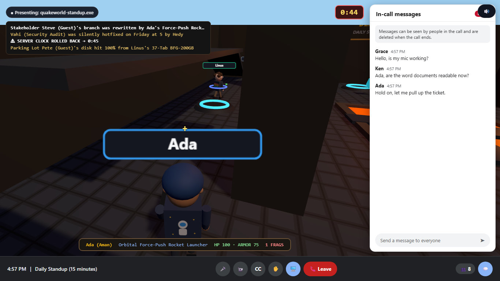

*Standup Deathmatch on a 1366 × 768 screen inside the Google Meet call frame.*

---

## 4. 🕹️ The Claw of Destiny

A 3D arcade claw machine (`2–30` players) powered by choreographed physics and scaled to the 10s–120s duration slider:

- **Arcade cabinet & bobblehead capsules:** every active teammate drops into a glass arcade cabinet (**STANDUP-O-MATIC** or **THE ALGORITHM**) as a clear gachapon capsule containing their 3D bobblehead, paired with an animated joystick, **INSERT STORY POINTS** coin slot, and a **VIP LOUNGE** shelf for sitting-out teammates.
- **Choreographed 4-phase suspense:** the overhead **THE STANDUP** claw hunts with fake-outs, scoops the winner plus decoys, drops decoys with dev excuses, and cuts to low-angle **Chute Cam** as the sole survivor drops down the prize chute.
- **Scales with round length:** **10s–15s** (*Quick Grab*), **30s** (*Rigged Arcade*), and **60s–120s** (*Elimination Pit*).

  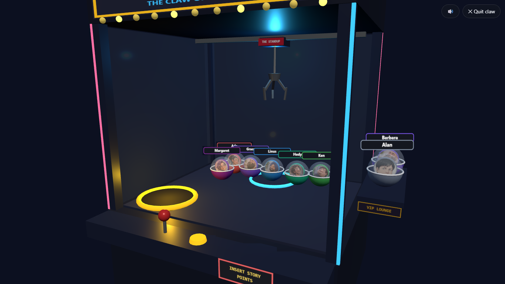

*The Claw of Destiny on a 1366 × 768 screen, with cooldown teammates relaxing on the VIP Lounge shelf.*

---

## 5. 🎰 Kanban Plinko

A 3D vertical pinball / pachinko gauntlet (`2–30` players) powered by 2.5D physics on a tilted 3D Kanban board:

- **4 Vertical Swimlanes:** glowing developer marbles drop from **1 · The Backlog** through **2 · In Progress** (pegs & **Scope Creep Bumpers**), **3 · Code Review & QA** (**Merge Conflict Spinners**, **Tech Debt Sticky Pads**, and **"Moved to Next Sprint" Warp Pipes**), and **4 · Deploy to Prod** (**LGTM Flippers** guarding **PROD / LEAD STANDUP**).
- **Duration scaling & safeguards:** **10s–15s** (*Hotfix Drop*), **30s** (*Standard Sprint*), and **60s–120s** (*Release Train*), backed by an Anti-Stuck micro-nudge and **Friday 4:55 PM Deploy** Force-Push fallback.

  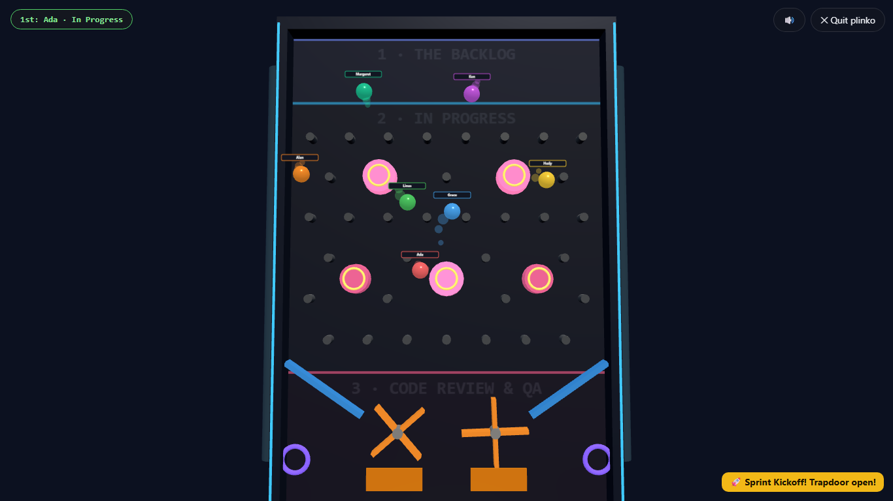

*Kanban Plinko on a 1366 × 768 screen.*

---

## 6. 🚦 Code Freeze

A 3D Red Light, Green Light survival sprint (`2–30` players) down a dark-mode neon CI/CD runway facing a swiveling **RELEASE MANAGER** laser turret:

- **3-State Cycle:** **GREEN (`SPRINT OPEN`)** → **YELLOW (`PR IN REVIEW`)** braking warning → **RED (`CODE FREEZE!`)** crimson laser sweep. Anyone still sliding gets zapped into binary particles with dev excuses.
- **Two Win Conditions:** first developer across the **RELEASE / LEAD STANDUP** finish tape, or the last developer standing.
- **Duration Scaling:** **10s–15s** (*Hotfix Dash*), **30s** (*Standard Release*), and **60s–120s** (*Enterprise Deployment* with **Tech Debt Ice** patches).

  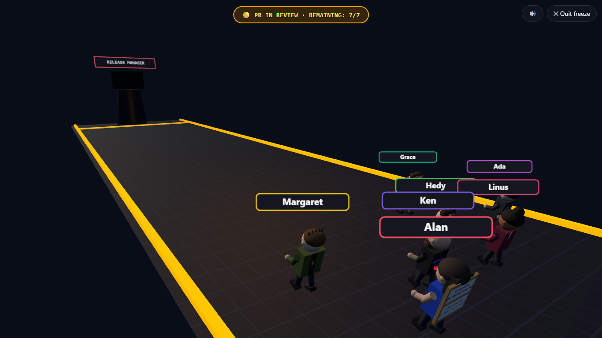

*Code Freeze on a 1366 × 768 screen.*

---

## 7. 🚀 Launchpad Roulette

A 3D Kerbal-style rocket ignition spectacle (`2–30` players) on a coastal Chesapeake Bay launch complex (`public/js/launchpad-sim.js`, `public/js/launchpad.js`):

- **Coastal Launch Complex & Responsive Pads:** every active teammate gets a detailed aerospace rocket arranged beneath **MISSION: STANDUP**, surrounded by Chesapeake Bay islands, a lighthouse, and drifting clouds.
- **6 Comedic Failure Archetypes:** Pad Fizzle, Spiral Corkscrew, Sideways Veer, Premature Staging, Mid-Air Stall & Parachute, and Cloud-Deck Heartbreak — until the sole survivor reaches **Prod Orbit**.
- **Flight Length Scaling:** **10s–15s** (*Hotfix Launch*), **30s** (*Two-Stage Ascent*), and **60s–120s** (*Orbital Gauntlet*).

  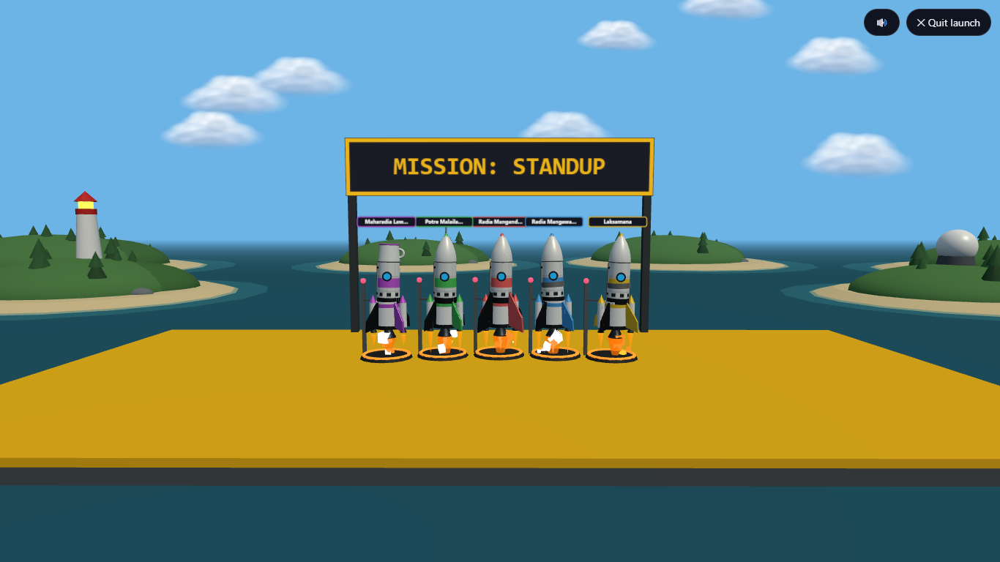

*Launchpad Roulette on a 1366 × 768 screen.*

---

## 8. 🧱 Jenga Connect

A 3D collapsing-tower survival spectacle (`2–30` players) atop a conference room table (`public/js/jenga-sim.js`, `public/js/jenga.js`):

- **Conference Room Setting & Wall Displays:** teammates stand atop a maple/birch Jenga tower of laser-etched legacy software packages on a walnut boardroom table, framed by the **Jenga Connect SOC Audit Log Plan** whiteboard and a live 4K stability/inclinometer display.
- **Automated `npm audit fix --force` Cursor & Fatal Keystone:** a glowing cursor slides blocks out until the crimson keystone triggers a `0.35×` slow-motion collapse where the sole survivor lands on the glowing `LTS-support` block.
- **Duration Scaling:** **10s–15s** (*Friday Patch*), **30s** (*Major Version Bump*), and **60s–120s** (*Full Monolith Migration*).

  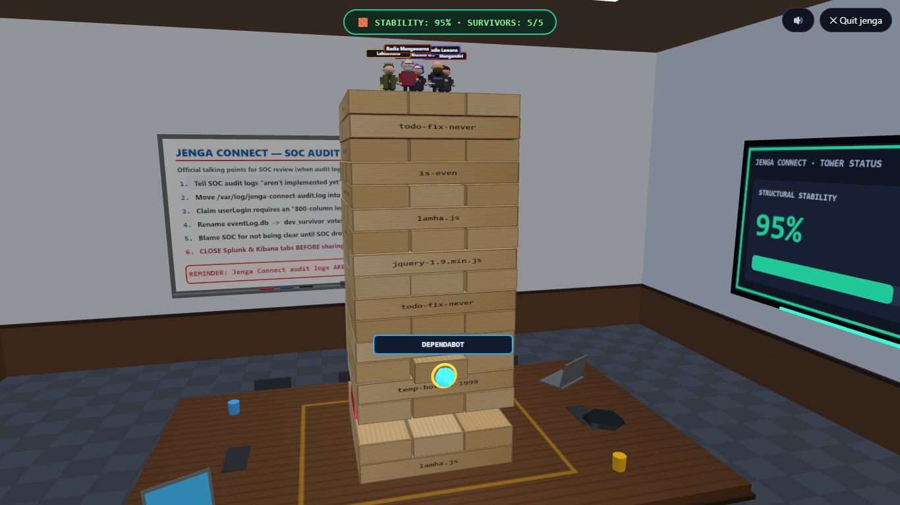

*Jenga Connect on a 1366 × 768 screen.*

---

## 9. 💣 Deploy Cannon

A 3D human-cannonball artillery volley (`2–30` players) over the Chesapeake Bay (`public/js/cannon-sim.js`, `public/js/cannon.js`):

- **Chesapeake Bay Pier & Brass Battery:** active teammates launch from gleaming brass circus cannons beneath a whipping windsock (`CROSSWIND: 24 KTS — SCOPE CREEP`) toward a bobbing concentric bullseye barge (`DEV → QA → STAGING → PROD`).
- **6 Reverse-Solved Flight Mishaps:** Pier Duds, Overshoots, Crosswind Drifts, Seagull Interceptions, Emergency Chutes, and Rim-Bounce Heartbreaks — ending in `0.4×` slow-motion **Barge Cam**.
- **Salvo Scaling:** **10s–15s** (*Hotfix Volley*), **30s** (*Two-Stage Qualification*), and **60s–120s** (*Artillery Showcase*).

  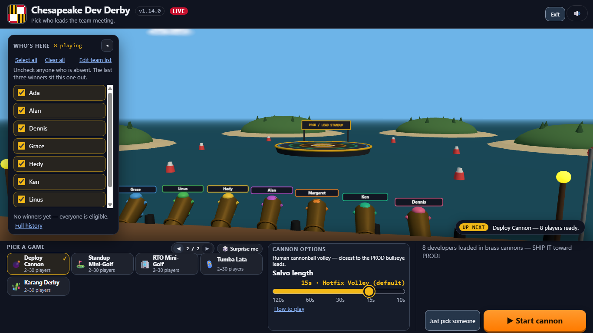

*Deploy Cannon on a 1366 × 768 screen.*

---

## 10. ⛳ Standup Mini-Golf

3D simultaneous putt-putt chaos (`2–30` players) floating over the Chesapeake Bay (`public/js/golf-sim.js`, `public/js/golf.js`):

- **Floating Chesapeake Putt-Putt Course:** team-striped golf balls roll across mowed astroturf framed by timber rails, Bay islands, a lighthouse, and sailboats.
- **2.5D Rolling Physics & 6 Dev Hazards:** **Sprint Review Windmills**, **BadalJwala Firewall Gates**, **Procurement Sand Traps**, **Legacy Code Water Hazards**, chrome **Scope Creep Bumpers**, and the **"One Quick Idea" Detour Boost**.
- **Course Scaling:** **10s–15s** (*Par-1 Hole-in-One Dash*), **30s** (*Par-3 Floating Course*), and **60s–120s** (*3-Hole Chesapeake Championship*).

  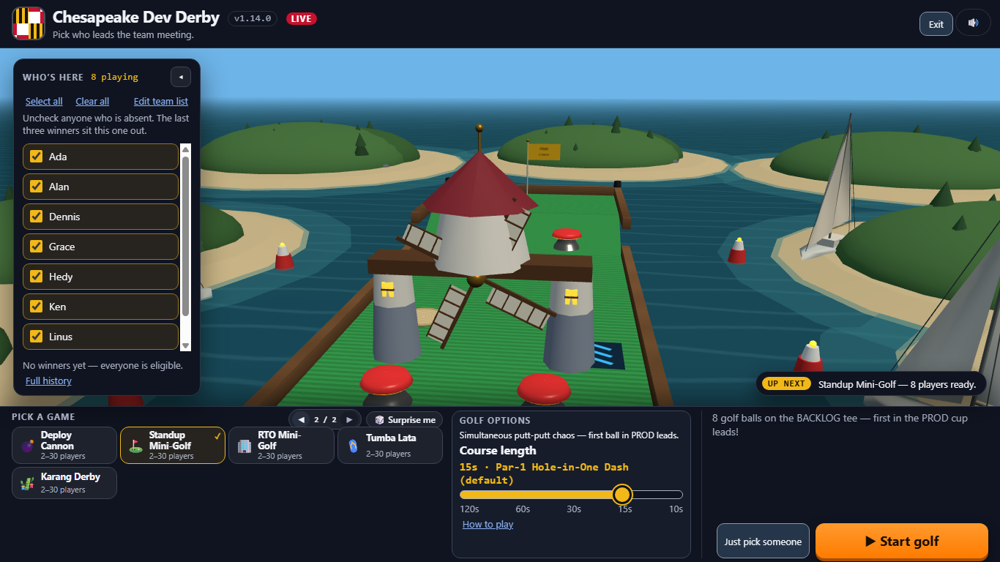

*Standup Mini-Golf on a 1366 × 768 screen.*

---

## 11. 🏢 RTO Mini-Golf

The *Return-to-Office Mandate Open* indoor cubicle putt-putt (`2–30` players; `public/js/rto-sim.js`, `public/js/rto.js`):

- **After-Hours IT Floor & Bobblehead Capsules:** developer portrait bobbleheads inside rolling gachapon capsules putt down a duct-taped emerald mat flanked by cubicles, IDE monitors, and 42U server racks.
- **6 Workplace Obstacles & Mug Finish:** spinning **Ergonomic Desk Chairs**, **3-Ring Binder Ramps**, **BadalJwala Jammed Copiers**, **Spilled Iced Coffee Puddles**, **`?ReturnUrl=`** detours, and **Retired Hardware Bumpers** leading into the tipped-over **`WORLD'S OKAYEST DEVELOPER`** ceramic coffee mug.
- **Course Scaling:** **10s–15s** (*Hallway Hotfix Dash*), **30s** (*Return-to-Office Mandate Open*), and **60s–120s** (*3-Hole "Instead of Raises" Championship*).

  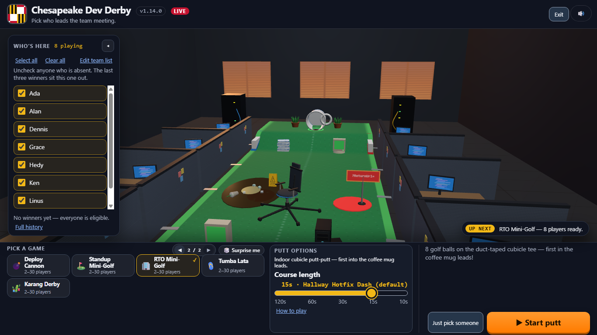

*RTO Mini-Golf on a 1366 × 768 screen.*

---

## 12. 🩴 Tumba Lata

A 3D *Slipper-Slinging Server Raid* (`2–30` players) adapted from the classic Bisayan street game (`public/js/tumba-sim.js`, `public/js/tumba.js`):

- **Twilight Fiesta Street & `SARI-SARI DEV SHOP`:** teammates hurl contoured 3D rubber *tsinelas* flip-flops from behind the glowing chalk *badlis* at the **`PROD SERVER`** tin can guarded by an overworked AI **Bantay**.
- **Two-Act Chaos (`BATO!` → Hunting Mode):** knock the can flying, sprint out to retrieve your slipper, and race back before the Bantay resets the can and flashes the streetlamps red.
- **Round Scaling:** **10s–15s** (*Street Blitz*), **30s** (*Classic Barangay Round*), and **60s–120s** (*Fiesta Elimination*).

  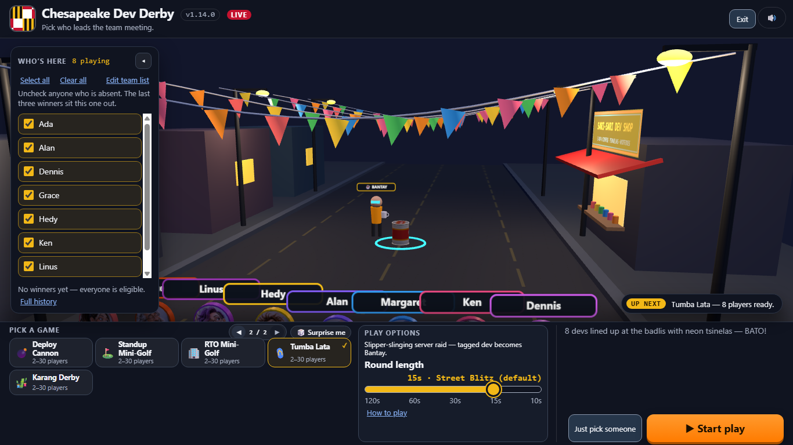

*Tumba Lata on a 1366 × 768 screen.*

---

## 13. 🎋 Karang Derby

A 3D Cebuano bamboo stilt wobble race (`2–30` players) down a moonlit twilight fiesta boulevard (`public/js/karang-sim.js`, `public/js/karang.js`):

- **Bamboo (`Kawayan`) & Coconut-Shell (`Bagol 🥥`) Stilts:** toggle between tall segmented bamboo poles and coconut-shell *bagol* stilts under a full moon, paper lanterns, and *banderitas*.
- **Inverted-Pendulum Wobble & Fiesta Hazards:** dodge **PanganodSilab 500 Crosswind** gusts, coffee slicks, snapped legacy poles, and clotheslines in a `0.45×` slow-motion finish.
- **Course Scaling:** **10s–15s** (*Barangay Sprint*), **30s** (*Fiesta Obstacle Derby*), and **60s–120s** (*Grand Cebu-Chesapeake Relay*).

  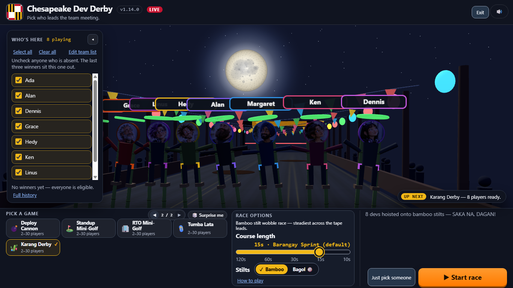

*Karang Derby on a 1366 × 768 screen.*

---

## 14. 💧 Tubig-Tubig

A 3D twilight Filipino *Patintero* / *Tubig-Tubig* court dash (`2–30` players; `public/js/tubig-sim.js`, `public/js/tubig.js`):

- **Glowing Water-Line Grid:** sprint across illuminated water-chalk lanes guarded by agile AI line-patrol taggers (**Taya**).
- **Rules Toggle:** **Champion** (last runner crossing cleanly wins) or **First Tag** (first runner tagged leads standup), scaling across **10s–120s**.

---

## 15. 🁣 Domino Slam

A 3D Jamaican rum-shop tabletop shockwave showdown (`2–30` players; `public/js/domino-sim.js`, `public/js/domino.js`):

- **Scarred Mahogany Tabletop:** heavy bone-ivory domino slams send radial shockwaves rippling across the table, bouncing rival devs toward the edge.
- **Rules Toggle:** **Champion** (last dev standing on the table) or **Six-Love** (first dev knocked off the table), scaling across **10s–120s**.

---

## 16. 🌴 Greasy Pole

A 3D Mashramani slip-and-slide climb (`2–30` players; `public/js/pole-sim.js`, `public/js/pole.js`):

- **Slick Timber Pole & Mud Pit:** devs scramble up a greased festival pole in bursts, sliding back in comical chain reactions when the grip gives out.
- **Rules Toggle:** **Summit** (first to grab the summit banner) or **Mud-Drop** (first dev to splash into the mud pit), scaling across **10s–120s**.

---

## 17. 🔮 Taw Knockout

A 3D executive boardroom ring-out marbles showdown (`2–30` players; `public/js/taw-sim.js`, `public/js/taw.js`):

- **Conference Room Walnut Table:** rolling developer bobblehead capsules battle inside a shrinking glowing chalk circle while dodging a rogue chrome **Steelie Boler**, framed by a 6-step **SOC Audit Log Plan** whiteboard, 4K TV, Chesapeake sky windows, and tall double doors.
- **Rules Toggle:** **Champion** (last marble inside the ring) or **First Out** (first marble knocked off the table), scaling across **10s–120s**.

---

## 18. 🟥 Ddakji Flip-Out

A 3D traditional South Korean Hanok executive boardroom paper-tile slam royale (`2–30` players; `public/js/ddakji-sim.js`, `public/js/ddakji.js`):

- **Hanok Conference Room & Portrait Tiles:** every teammate is an origami paper *ddakji* tile featuring their developer portrait resting on embroidered silk *bangseok* cushions, slammed by crimson/cobalt **CHEOL-DDAKJI** shockwaves.
- **Rules Toggle:** **Champion** (last unflipped tile) or **First Flip** (first tile flipped over), scaling across **10s–120s**.

---

## 19. 📺 Nōkabe Wall Crunch

A daytime outdoor Japanese TV game-show *Hole in the Wall* poolside set (`2–30` players; `public/js/nokabe-sim.js`, `public/js/nokabe.js`):

- **Outdoor Poolside TV Set:** teammates strike poses on a non-slip hazard-chevron stage dock above a recessed turquoise pool as beaded-styrofoam cutout walls glide down brushed-steel rails, cheered on by Red/Blue Team stadium grandstands packed with wildlife spectators.
- **Rules Toggle:** **Stay Dry** (last dry survivor) or **First Splash** (first dev knocked into the pool), scaling across **10s–120s**.

---

## 20. 🀄 Mahjong Tile Wash

A 3D Chinese tea-house parlor *Xǐpái* whirlpool rumble (`2–30` players; `public/js/mahjong-sim.js`, `public/js/mahjong.js`):

- **Automatic Mahjong Table:** 144 swirling ivory-and-jade tiles churn across emerald baize while **PONG!** Red Dragon clamps, ricocheting dice, **East Wind Reversals**, and the recessed brass **Auto-Shuffle Chute** eliminate careless devs—framed by a warm 4-wall parlor with a single full-moon window and **`審計日誌 · AUDIT LOG PARLOR RULES`** board.
- **Rules Toggle:** **Hú!** (last dev standing) or **Fàngpào** (first dev swallowed by the open chute), scaling across **10s–120s**.

---

## 21. 🪑 Kho-Kho Relay Blitz

A 3D swivel-chair IT executive boardroom directional chase (`2–30` players; `public/js/khokho-sim.js`, `public/js/khokho.js`):

- **Late-Evening Boardroom Spine:** runners sprint the North/South aisles, whipping 180° around the **West Rolling Projector Cart** and **East Chai & Samosa Trolley** while dodging rolling **P1 ESCALATION** chasers and **`KHO!`** chair-slap ambushes launched by realistic tailored seated executives. Includes dual whiteboards (with **`S`** key and Projector-click zoom Easter eggs) and executive double doors.
- **Rules Toggle:** **Elusive** (last runner untagged) or **First P1** (first runner tagged), scaling across **10s–120s**.

---

## 22. 🐚 Chaupar Cowrie-Clash

A 3D modern Bengaluru tech conference room (`CUBBON BOARDROOM · BLR-04`) cross-board *Pachisi* derby (`2–30` players; `public/js/chaupar-sim.js`, `public/js/chaupar.js`):

- **Bengaluru Boardroom & Embroidered Cloth:** overlooking Bengaluru's Outer Ring Road IT towers, Namma Metro, and painterly Garden City rain-tree/gulmohar canopy, turned-wood dev pawns hop along a crimson-and-emerald gold-stitched *chaupar* cloth propelled by colossal bouncing ivory cowrie shells (*kaudi*), dodging **`KAAT DIYA!`** wastebasket cuts, **`SHAKUNI`** safe-tile flips, and Polycom speakerphone quakes.
- **Rules Toggle:** **Charkoni** (first pawn to claim the central throne) or **First Cut** (first pawn flicked into the metal wastebasket), scaling across **10s–120s**.

---

## 23. 🌉 Glass Bridge Deploy

A 3D 4-lane dusk commuter suspension bridge crossing (`2–30` players; `public/js/glass-sim.js`, `public/js/glass.js`):

- **Two Middle Glass Lanes + Two Outer Street Lanes:** numbered-vest devs (`01`–`30`) leap across 50/50 **TESTED (TEMPERED)** vs. **UNTESTED PROD (FRAGILE)** glass panels suspended over dusk bay water, flanked by two outer asphalt commuter lanes full of sculpted car accidents, rising wispy radiator smoke plumes, blinking hazard lights, arched-davit streetlights, and standing executive guards beneath the **`DEPLOY TO CLINIC`** arch.
- **Rules Toggle:** **Survivor** (first dev across all glass pairs) or **Canary** (first dev to plummet through a shattered pane), scaling across **10s–120s**.
