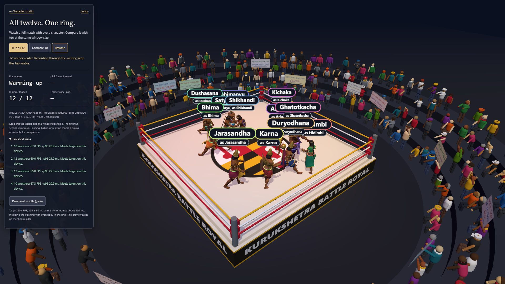

# Twelve-wrestler performance results

**Result: twelve HD characters pass on the tested machine.** The normal wrestling limit has been raised
from ten to twelve. Both twelve-character runs completed all eleven eliminations and the
victory sequence, with every character using the new skinned model.

These measurements cover the lobby's **HD** option. **Let’s Rumble** selects the original
models instead; both choices share the twelve-participant limit and match rules.

Open [the performance test](http://127.0.0.1:4100/wrestling-performance.html) after starting the
app, or choose **Run all 12 · performance test** in the character studio.

## Measurements

Measured November 16, 2026. Full matches were run in **10, 12, 12, 10** order to check repetition
and reduce first-run/order effects. The two ten-person matches used the same opening ten
characters as the twelve-person matches. All runs passed the predeclared target.

| Run | Wrestlers | Full-match FPS | Full-match p95 interval | FPS while everyone was in-ring | Full-ring p95 interval |
| --- | ---: | ---: | ---: | ---: | ---: |
| 1 | 10 | 67.3 | 20.9 ms | 87.9 | 14.0 ms |
| 2 | 12 | 55.8 | 27.8 ms | 74.6 | 20.8 ms |
| 3 | 12 | 60.0 | 21.0 ms | 80.8 | 14.0 ms |
| 4 | 10 | 67.0 | 20.9 ms | 90.0 | 14.0 ms |

There were **zero sampled frame intervals above 100 ms**, no hidden/resized/paused interruptions,
and no uncaught JavaScript exceptions in these four runs. Each twelve-person run recorded more
than 4,000 full-match frames and more than 480 frames while all twelve were still in the ring.

The added two characters reduced mean FPS by about **14%** across the two runs per size. The
slowest twelve-person result still had substantial room above the 30 FPS target. The late-match
sections, with eliminated characters seated around the ring, were slower than the opening.

The maximum reported render draw calls rose from approximately 546 to 639. CPU match updates
averaged approximately 8.3 ms with ten versus 9.5–10.0 ms with twelve; render submission averaged
6.3 ms versus 6.9–7.6 ms. These are CPU measurements, not GPU execution times. Repeated
twelve-person runs had the same reported geometry/texture counts (545 geometries, 99 textures).

The [raw JSON reports](wrestling-performance.json) include each run's environment, characters,
timings, elimination count, stage summaries, memory counts and pass/fail assessment.

After enabling twelve in the normal app, all **130 automated tests** passed. Browser checks
also confirmed that the lobby admits twelve and displays all twelve HUD entries, thirteen is
still disabled, and paused/resized/incomplete benchmark runs are flagged and can be exported.

## Test conditions

- Windows, Chrome 157 in headless mode **with hardware acceleration enabled**.
- Active WebGL renderer: **AMD Radeon(TM) Graphics, ANGLE/D3D11**, not SwiftShader/software rendering.
- **1920 × 1080 drawing buffer**, device pixel ratio 1, antialiasing enabled.
- Same match scene, skinned models, crowd, lights, shadows, name tags, camera, effects and
  simulation time-step cap as the normal wrestling renderer. The benchmark does not run the
  lobby scene or meeting-result UI/audio.
- Assets were prepared once before the run sequence. Shader/animation warmup excluded the first
  two seconds of each match from timing statistics; startup/build times are recorded separately.
- Seed 17 for the match plan, identical initial camera orientation. Background visual choices
  still use the match's normal randomness; the test is repeatable, not a pixel-identical replay.
- Every match ran at normal speed through three seconds of victory: approximately 65 seconds
  for ten characters and 77 seconds for twelve. No accelerated simulation was substituted.
- No CPU-heavy automated test suite ran during the timing sequence.

FPS is the number of sampled frames divided by their total elapsed interval. A p95 of 27.8 ms
means 95% of sampled animation-frame intervals were at or below that value. It measures browser
frame pacing, including scheduling, rather than only the JavaScript render-call duration.

## Acceptance target

Both the complete match sample and the opening sample with everybody in the ring must have:

- At least 120 recorded frames.
- Average frame rate of at least **30 FPS**.
- A p95 frame interval of at most **50 ms**.
- No more than **1%** of intervals above **100 ms**.

The match must finish, observe all eliminations, and use skinned models for all participants.
Pausing, hiding the tab, resizing, or losing the WebGL context invalidates the comparison.
The 30 FPS threshold is the minimum chosen for this meeting animation; the actual twelve-person
results were considerably higher.

## Run it on your presentation setup

1. Start the app and open `wrestling-performance.html`. It starts all twelve automatically.
2. Keep the tab visible, at the window size/zoom you use for meetings, until a winner is recorded.
3. Click **Compare 10**, then repeat **Run all 12** at the same size.
4. Repeat while using your normal screen-sharing application to assess that extra load.
5. Click **Download results (.json)** to save the measurements. **Pause** is available to inspect
   the ring, but restart afterward to obtain a valid comparison.

The page saves no team names, winners or meeting history. Its counts are independent of the
current attendance list. `?autostart=0` waits for a button; `?count=10` starts the baseline.

These results support raising this app's limit to **twelve on the tested hardware**. High-DPI
screens, software rendering, other GPUs and screen-sharing load can change the result. More
than twelve participants have not been measured or enabled; the twelve-person cap also keeps
the entire roster distinct.
