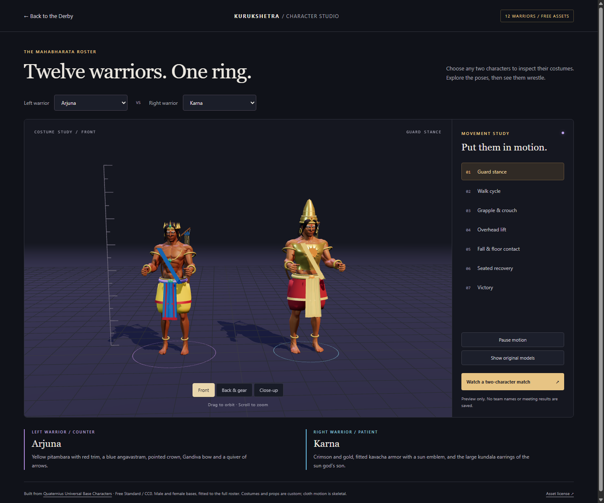

# Wrestling character studio

All twelve Mahabharata wrestlers now use free skinned models with custom costumes. Open
the permanent **Preview wrestlers** link below the lobby's Rumble/HD buttons, or visit
<http://127.0.0.1:4100/character-prototype.html> after starting the app.

The studio defaults to Ghatotkacha and Abhimanyu, the largest and smallest characters. Use the
left/right selectors to inspect any two warriors, or open
[Arjuna directly](http://127.0.0.1:4100/character-prototype.html?character=arjuna).

## What to try

- Drag to orbit and scroll/pinch to zoom. Front, Back & gear and Close-up offer preset views.
- Check the seven poses, especially walking, overhead lift, lying flat and seated recovery.
- Pause to inspect a costume, and compare it with **Show original models**.
- Watch a match, then replay to reverse the winner's character and exercise the other direction.
- Return to the studio with any pose or camera button. Selected pairs can be shared using the URL.

Studio matches do not use the team roster or save meeting results. In the lobby, **Let’s Rumble**
uses the original models and the adjacent **HD** button uses these new models. Both support all
twelve characters, with the same winner selection and timing. HD falls back to the original
procedural roster if its local model files fail to load.

For all twelve at once, use **Run all 12 · performance test**. The [performance report](wrestling-performance.md)
records the full-match measurements that support the normal app's new twelve-person limit.

## Character identities

| Warrior | Costume and equipment |
| --- | --- |
| Bhima | Broad build, saffron dhoti, gold sash, curled mustache, iron mace |
| Jarasandha | Maroon and gold, ruby crown, full beard, a seam down the torso |
| Duryodhana | Royal blue, jeweled crown, crimson cape, golden mace |
| Kichaka | Heavy build, forest green, thick mustache, headband, sheathed sword |
| Arjuna | Yellow pitambara, red trim, blue angavastram, crown, Gandiva and quiver |
| Karna | Crimson and gold, fitted sun armor, large earrings, bow and arrows |
| Abhimanyu | Smallest build, sky blue, white sash, small crown, blue shield |
| Ghatotkacha | Tallest build, purple and lilac, wild hair, tusks, glowing amulet, mace |
| Hidimbi | Female base, green choli/skirt, braid, tiara, nose ring and earrings |
| Dushasana | Kaurava green and gold, short beard, emerald crown, golden mace |
| Shikhandi | Violet dhoti, pale sash, pointed crown, purple shield |
| Satyaki | Teal and gold, peacock feather in the headband, sheathed sword |

## Free assets and construction

Only the $0 **Universal Base Characters [Standard]** archive from
[Quaternius](https://quaternius.itch.io/universal-base-characters) is used. Its free inventory
includes male/female Superhero bodies and a subset of hair. It does not include Regular or Teen
bodies. The roster uses different proportions over those two bases; Abhimanyu is a smaller
stylized warrior rather than an imported Teen mesh. No paid Source/Pro assets or animation packs
are included.

The actual imported skeleton and weights animate each body. Custom clothing receives weights
from nearby base-body vertices; rigid jewelry and equipment attach to bones. Body triangles
hidden beneath the garments are masked to prevent hips/thighs from poking through. Hair, beard
and skin textures come from the free pack. The procedural pose adapter handles walking,
grappling, overhead motion and recovery; special match effects remain in the existing script.

The main files are:

- `public/js/wrestler-looks.js`: proportions, colors, accessories and descriptions for each character.
- `public/js/wrestler-models.js`: asset loading, costume construction, skinning and pose adaptation.
- `public/js/wrestlers.js`: shared model/label API, floor contact and the original-model fallback.
- `scripts/prepare-wrestler-assets.py`: reproducible packing from the free ZIP; requires Python/Pillow.
- `public/assets/wrestlers/`: GLB models, skin texture, original CC0 license and a hashed manifest.

Runtime assets total approximately **15.6 MB** (decimal) before HTTP compression, with PNGs capped
at 1024 pixels. Models are loaded lazily and shared immutable assets stay cached for the page's
lifetime. Match instances have independent skeletons/materials and release their own resources.
The server and static demo both host all required assets and Three.js addons locally.

See [models.md](../models.md) for the simple Arjuna build guide and download links.

## Remaining visual limits

Garments use skin weights rather than cloth simulation, so deep bends can still show artificial
folds. Grappling contact, size-dependent lifts and rope clearance follow the original scripted
motions; authored paired clips or IK would improve them. There is no facial animation or ragdoll.
The free male base remains muscular even when narrowed for the smaller characters.

Automated checks cover all twelve recipes, characteristic equipment, independent skeletons,
direction of arm poses, grounding through movement and lying flat, carried-gear exclusion, asset
hashes, and demo packaging. Browser checks inspect front/back views, pose changes and studio
controls. Performance while screen sharing on a representative meeting laptop still deserves a
human check.

The completed roster passed **123 automated tests**. Browser checks exercised all twelve
characters in seven poses, both Hidimbi/Arjuna match winners, a ten-person setup with ten skinned
models, original/new comparison, a 390-pixel viewport, subdirectory hosting, and recovery from a
failed female-model download. No uncaught JavaScript errors or unexpected HTTP errors occurred.
